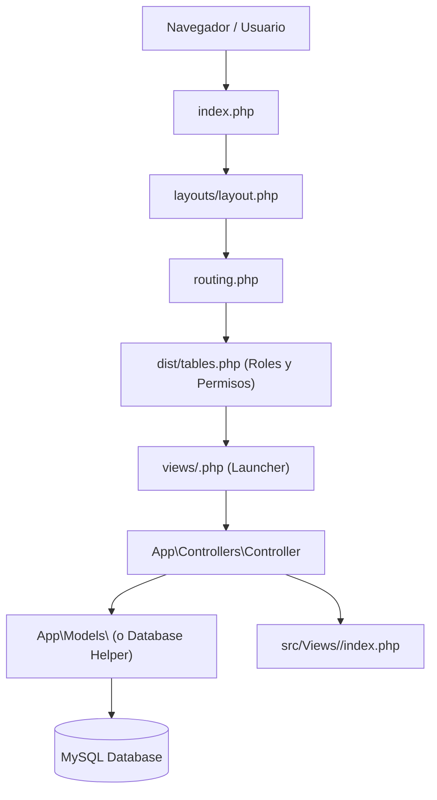
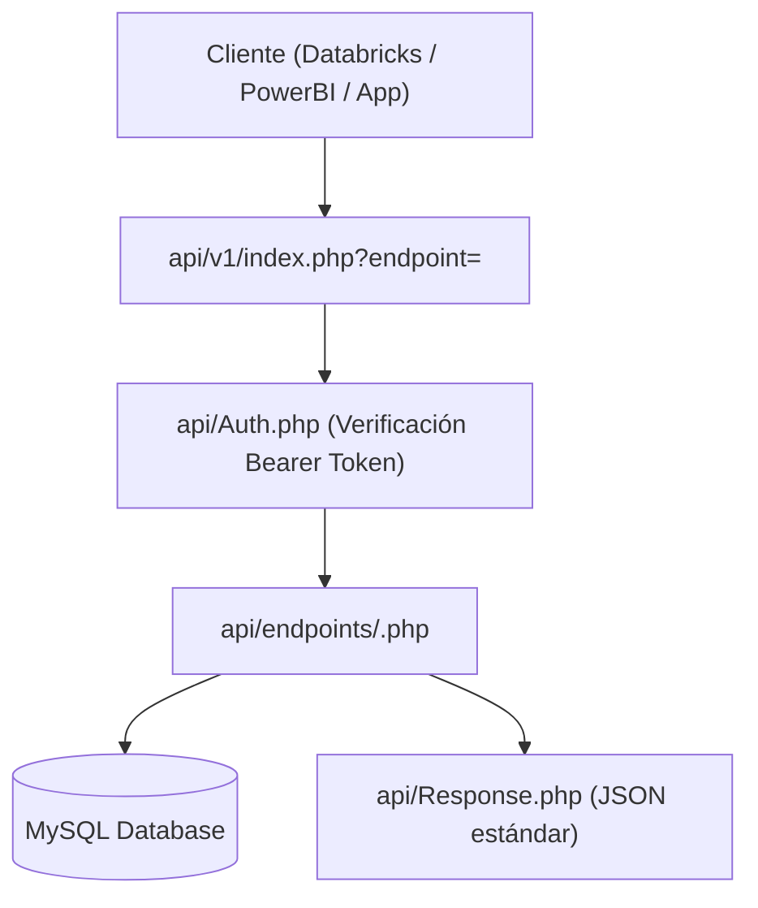

# Guía de Arquitectura y Desarrollo con IA (Inverpalmas 2026 Ready)

Esta guía documenta los estándares técnicos, convenciones de diseño y patrones arquitectónicos para desarrolladores y modelos de Inteligencia Artificial (AI Coding Assistants) que construyan o extiendan módulos en el sistema **Inverpalmas**.

---

## 1. Stack Tecnológico a la Vanguardia (2026)

| Componente | Versión / Tecnología | Propósito |
| :--- | :--- | :--- |
| **Backend** | **PHP 8.2+** (PSR-4, `declare(strict_types=1);`) | Lógica MVC robusta, orientada a objetos y con tipado estricto. |
| **Diseño / UI** | **Bootstrap 5.3.3** (`vendor/twbs/bootstrap5/`) | Sistema de diseño moderno, CSS variables (`--bs-primary: #00796B`), flex, grid y componentes nativos. |
| **DOM / Plugins** | **jQuery 3.7.1** (`vendor/components/jquery/`) | Última versión segura y optimizada, 100% compatible con DataTables y plugins sin vulnerabilidades. |
| **Tablas** | **DataTables + Bootstrap 5 adapter** | DataTables con FixedColumns, Buttons (Excel, CSV, Copiar, Print) y estilo Bootstrap 5. |
| **Tipografía / Iconos** | **Inter Font** + **Material Icons** (locales) | Tipografía estándar de aplicaciones SaaS de alta legibilidad y set de iconos de Google. |
| **API** | **RESTful JSON API** (`api/v1/`) | Autenticación Bearer Token, respuestas paginadas uniformes y soporte dinámico de endpoints. |

---

## 2. Convenciones Críticas de Bootstrap 5

En todos los desarrollos nuevos y mantenimiento, **utilizar exclusivamente sintaxis Bootstrap 5**:

| Función | Bootstrap 4 (Obsoleto) | Bootstrap 5 (Estándar Actual) |
| :--- | :--- | :--- |
| **Márgenes** | `mr-*`, `ml-*` | `me-*` (margin-end), `ms-*` (margin-start) |
| **Rellenos** | `pr-*`, `pl-*` | `pe-*` (padding-end), `ps-*` (padding-start) |
| **Alineación de Texto** | `text-left`, `text-right` | `text-start`, `text-end` |
| **Grosor de Fuente** | `font-weight-bold`, `font-weight-normal` | `fw-bold`, `fw-semibold`, `fw-normal` |
| **Badges / Insignias** | `badge badge-pill badge-primary` | `badge rounded-pill bg-primary text-white` |
| **Botón Cerrar Modal/Alert** | `<button class="close" data-dismiss="modal">` | `<button class="btn-close" data-bs-dismiss="modal">` |
| **Data Attributes** | `data-toggle="modal"`, `data-target="#id"` | `data-bs-toggle="modal"`, `data-bs-target="#id"` |
| **Gaps en Filas / Grids** | `.form-row`, márgenes negativos | `row g-3`, `gap-2`, `row-cols-md-2` |
| **Formularios Flotantes** | N/A | `.form-floating` |

---

## 3. Ciclo de Vida de una Petición (Request Lifecycle)



Para la **API REST**:


---

## 4. Plantillas Listas para Usar (Copy & Paste)

### 4.1. Crear un Nuevo Controlador (`src/Controllers/EjemploController.php`)
Extiende siempre de `App\Controllers\BaseController`:

```php
<?php
declare(strict_types=1);

namespace App\Controllers;

use App\Models\EjemploModel;

class EjemploController extends BaseController
{
    public function index(): void
    {
        $this->requireAuth();

        $filtros = [
            'finca' => $this->get('finca', 'TODAS'),
            'estado' => $this->get('estado', 'ACTIVO'),
        ];

        $kpis = EjemploModel::obtenerKpis($filtros);
        $registros = EjemploModel::obtenerListado($filtros);

        $this->render('Ejemplo/index', [
            'filtros'   => $filtros,
            'kpis'      => $kpis,
            'registros' => $registros,
        ]);
    }

    public function guardar(): void
    {
        $this->requireAuth();

        if (!$this->isPost()) {
            $this->jsonError('Método no permitido', 405);
        }

        $datos = $this->jsonInput() ?: $_POST;
        $id = EjemploModel::guardar($datos);

        $this->jsonSuccess(['id' => $id], 'Registro guardado exitosamente', 201);
    }
}
```

### 4.2. Crear un Nuevo Modelo con Consultas Seguras (`src/Models/EjemploModel.php`)
Usa el helper `App\Helpers\Database` con sentencias preparadas:

```php
<?php
declare(strict_types=1);

namespace App\Models;

use App\Helpers\Database;

class EjemploModel
{
    public static function obtenerListado(array $filtros): array
    {
        $sql = "SELECT id, nombre, finca, fecha, total 
                FROM ejemplo_tabla 
                WHERE 1=1";
        $params = [];

        if (!empty($filtros['finca']) && $filtros['finca'] !== 'TODAS') {
            $sql .= " AND finca = ?";
            $params[] = $filtros['finca'];
        }

        $sql .= " ORDER BY fecha DESC LIMIT 500";

        return Database::fetchAll($sql, $params);
    }

    public static function obtenerKpis(array $filtros): array
    {
        $sql = "SELECT COUNT(*) as total_registros, COALESCE(SUM(total), 0) as suma_total 
                FROM ejemplo_tabla";
        return Database::fetchOne($sql) ?? ['total_registros' => 0, 'suma_total' => 0];
    }

    public static function guardar(array $datos): int
    {
        return Database::insert('ejemplo_tabla', [
            'nombre' => (string)($datos['nombre'] ?? ''),
            'finca'  => (string)($datos['finca'] ?? ''),
            'total'  => (float)($datos['total'] ?? 0),
            'fecha'  => date('Y-m-d H:i:s'),
        ]);
    }
}
```

### 4.3. Crear la Vista Bootstrap 5 (`src/Views/Ejemplo/index.php`)
Estructura limpia con Header, KPIs, Filtros, Tabla y Modal nativo de Bootstrap 5:

```php
<div class="container-fluid px-3 px-lg-4 py-3">
    <!-- 1. Encabezado de Página -->
    <div class="d-flex flex-wrap justify-content-between align-items-center mb-4 pb-2 border-bottom">
        <div>
            <h1 class="h4 fw-bold text-dark mb-1 d-flex align-items-center">
                <span class="material-icons text-primary me-2" style="font-size: 1.8rem;">analytics</span>
                Gestión de Módulo Ejemplo
            </h1>
            <p class="text-muted small mb-0">Descripción concisa y profesional del módulo.</p>
        </div>
        <div class="d-flex gap-2 mt-2 mt-md-0">
            <button type="button" class="btn btn-outline-secondary btn-sm d-flex align-items-center" onclick="exportarExcel()">
                <span class="material-icons me-1" style="font-size: 1.1rem;">file_download</span> Exportar
            </button>
            <button type="button" class="btn btn-success btn-sm d-flex align-items-center" data-bs-toggle="modal" data-bs-target="#modalNuevo">
                <span class="material-icons me-1" style="font-size: 1.1rem;">add</span> Nuevo Registro
            </button>
        </div>
    </div>

    <!-- 2. Grid de KPIs (Responsive) -->
    <div class="row g-3 mb-4">
        <div class="col-12 col-sm-6 col-xl-3">
            <div class="card border-0 shadow-sm p-3">
                <div class="d-flex align-items-center justify-content-between">
                    <div>
                        <span class="text-muted small fw-semibold text-uppercase">Total Registros</span>
                        <h3 class="fw-bold mb-0 mt-1"><?php echo number_format($kpis['total_registros'] ?? 0); ?></h3>
                    </div>
                    <span class="material-icons text-primary bg-light p-2 rounded-circle" style="font-size: 1.8rem;">inventory_2</span>
                </div>
            </div>
        </div>
    </div>

    <!-- 3. Tabla de Datos -->
    <div class="card border-0 shadow-sm">
        <div class="card-body p-3">
            <div class="table-responsive">
                <table class="table table-hover align-middle display nowrap w-100" id="tablaEjemplo">
                    <thead class="table-light">
                        <tr>
                            <th>ID</th>
                            <th>Nombre</th>
                            <th>Finca</th>
                            <th>Fecha</th>
                            <th class="text-end">Total</th>
                            <th class="text-center">Acciones</th>
                        </tr>
                    </thead>
                    <tbody>
                        <?php foreach ($registros as $row): ?>
                            <tr>
                                <td><?php echo (int)$row['id']; ?></td>
                                <td class="fw-semibold"><?php echo htmlspecialchars($row['nombre']); ?></td>
                                <td><span class="badge rounded-pill bg-light text-dark border"><?php echo htmlspecialchars($row['finca']); ?></span></td>
                                <td><?php echo htmlspecialchars($row['fecha']); ?></td>
                                <td class="text-end fw-bold"><?php echo number_format((float)$row['total'], 2); ?></td>
                                <td class="text-center">
                                    <button class="btn btn-sm btn-outline-primary" onclick="editar(<?php echo (int)$row['id']; ?>)">
                                        <span class="material-icons" style="font-size: 1rem;">edit</span>
                                    </button>
                                </td>
                            </tr>
                        <?php endforeach; ?>
                    </tbody>
                </table>
            </div>
        </div>
    </div>
</div>

<!-- Modal Nativo Bootstrap 5 -->
<div class="modal fade" id="modalNuevo" tabindex="-1" aria-labelledby="modalNuevoLabel" aria-hidden="true">
    <div class="modal-dialog modal-dialog-centered">
        <div class="modal-content border-0 shadow-lg" style="border-radius: 12px;">
            <div class="modal-header">
                <h5 class="modal-title fw-bold" id="modalNuevoLabel">Nuevo Registro</h5>
                <button type="button" class="btn-close" data-bs-dismiss="modal" aria-label="Cerrar"></button>
            </div>
            <div class="modal-body">
                <form id="formNuevo">
                    <div class="mb-3">
                        <label class="form-label small fw-semibold" for="inputNombre">Nombre</label>
                        <input type="text" class="form-control" id="inputNombre" required>
                    </div>
                </form>
            </div>
            <div class="modal-footer">
                <button type="button" class="btn btn-outline-secondary" data-bs-dismiss="modal">Cancelar</button>
                <button type="button" class="btn btn-success" onclick="guardarRegistro()">Guardar</button>
            </div>
        </div>
    </div>
</div>

<script>
$(document).ready(function() {
    $('#tablaEjemplo').DataTable({
        pageLength: 25,
        language: {
            url: '//cdn.datatables.net/plug-ins/1.13.7/i18n/es-ES.json'
        }
    });
});
</script>
```

### 4.4. Crear un Nuevo Endpoint en la API (`api/endpoints/ejemplo.php`)
Al crear este archivo en `api/endpoints/`, queda disponible automáticamente en `GET/POST /api/v1/?endpoint=ejemplo`:

```php
<?php
declare(strict_types=1);

// Parámetros de consulta
$finca    = isset($_GET['finca']) ? trim((string)$_GET['finca']) : null;
$page     = max(1, (int)($_GET['page'] ?? 1));
$pageSize = min(1000, max(1, (int)($_GET['pageSize'] ?? 100)));
$offset   = ($page - 1) * $pageSize;

$sql = "SELECT id, nombre, finca, fecha, total FROM ejemplo_tabla WHERE 1=1";
$params = [];

if ($finca !== null && $finca !== '') {
    $sql .= " AND finca = ?";
    $params[] = $finca;
}

// Conteo total
$stmtCount = $conexion->prepare(str_replace('SELECT id, nombre, finca, fecha, total', 'SELECT COUNT(*)', $sql));
if (!empty($params)) {
    $stmtCount->bind_param(str_repeat('s', count($params)), ...$params);
}
$stmtCount->execute();
$total = (int)$stmtCount->get_result()->fetch_row()[0];
$stmtCount->close();

// Paginación
$sql .= " ORDER BY id DESC LIMIT ? OFFSET ?";
$params[] = $pageSize;
$params[] = $offset;

$types = str_repeat('s', count($params) - 2) . 'ii';
$stmt = $conexion->prepare($sql);
$stmt->bind_param($types, ...$params);
$stmt->execute();
$data = $stmt->get_result()->fetch_all(MYSQLI_ASSOC);
$stmt->close();

Response::paginate($data, $total, $page, $pageSize, ['finca' => $finca]);
```

---

## 5. Registrar el Módulo en el Sistema

1. **Launcher**: Crear `views/ejemplo.php`:
   ```php
   <?php
   require_once dirname(__DIR__) . '/src/autoload.php';
   $controller = new \App\Controllers\EjemploController();
   $controller->index();
   ```
2. **Ruta**: Agregar en `dist/tables.php` dentro del array `$tablas` o `$reportes`:
   ```php
   'ejemplo' => 'views/ejemplo.php',
   ```
3. El módulo estará accesible en la URL: `index.php?report=ejemplo` o `index.php?table=ejemplo`.
